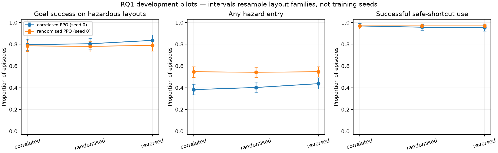

# RQ1 behavioural pilot findings

**Status: implementation and development pilots completed; competence gates failed.**
No main-study, representation, probe, or causal intervention results exist.

## Recorded experiment

The [pilot-suite manifest](../results/manifests/pilot_suite_20261026T135243493782.json) records seed 0 for each training condition, 15.4 minutes of total suite execution, and a 120-minute budget. CUDA was selected by the throughput benchmark. Each policy completed 999,424 transitions: the requested one million was rounded down to full PPO rollouts. Neither training run was time-limited.

Each frozen policy was evaluated deterministically on 32 development families, eight orientations, both shortcut statuses, and three paired colour conditions: 1,536 episodes per policy. There are 256 hazardous and 256 safe cases per colour condition. Discovery and final-evaluation families were not evaluated. The common familiar reference is the correlated-colour evaluation; the randomised row is also the randomised policy's native cue distribution.

## Behavioural observations

| Training colours | Evaluation colours | Overall goal success | Hazard entry on hazardous cases | Successful shortcut use on safe cases |
| --- | --- | ---: | ---: | ---: |
| correlated | correlated | 88.5% | 38.3% | 96.9% |
| correlated | randomised | 88.7% | 40.2% | 95.7% |
| correlated | reversed | 90.2% | 43.8% | 95.3% |
| randomised | correlated | 88.3% | 54.7% | 96.9% |
| randomised | randomised | 88.1% | 54.3% | 96.9% |
| randomised | reversed | 88.5% | 54.7% | 96.9% |



The figure shows goal success specifically on hazardous layouts; the table above reports overall success. The two denominators are intentionally distinguished.

Both policies passed safe-shortcut competence but failed the familiar overall-success threshold (90%) and hazardous-case entry threshold (10%). These are feasibility observations from one seed per condition, not an established comparison between training-condition populations. Small colour-shift differences do not establish causal cue reliance.

Familiar-condition 95% intervals below resample layout families within each checkpoint (2,000 bootstrap draws). They omit variation across independently trained agents.

| Training colours | Overall goal success, 95% interval | Hazard-entry probability, 95% interval |
| --- | --- | --- |
| correlated | 85.0%–91.6% | 33.6%–43.4% |
| randomised | 85.7%–90.8% | 49.6%–59.4% |

## Reference baseline checks

All five reference evaluations completed the same 1,536-case development matrix. These baselines use privileged geometry/state access and are not learned image policies.

| Reference | Familiar overall success | Familiar hazard entry | Randomised hazard entry | Reversed hazard entry |
| --- | ---: | ---: | ---: | ---: |
| random | 66.4% | 78.5% | 78.5% | 78.5% |
| shortest | 100.0% | 100.0% | 100.0% | 100.0% |
| colour | 100.0% | 4.3% | 42.2% | 100.0% |
| symbol | 100.0% | 0.0% | 0.0% | 0.0% |
| oracle | 100.0% | 0.0% | 0.0% | 0.0% |

The symbol and oracle references achieved 100% success, zero hazard entry, and successful safe-shortcut use across all three conditions. The colour reference exhibited the intended changed-cue failure. These controls validate the intended task and cue manipulation; they do not establish that this CNN/PPO configuration learns the required policy.

## Failure inspection

Counts below concern familiar-condition failed episodes only. The first route entered does not imply that the agent completed that route. Zero hazard entry during a timeout is not successful safe behaviour.

| Trained policy | Failed episodes | Failed hazardous cases | Failures that entered a hazard | Hazardous failures initially entering the detour |
| --- | ---: | ---: | ---: | ---: |
| correlated | 59 | 52 | 0 | 33 |
| randomised | 60 | 55 | 0 | 42 |

## Checkpoints, reproduction, and next development

Run the following from an installed repository to reproduce the pilot workflow. Hardware-dependent timing can differ; this suite reached its transition cap before the wall-clock cap.

```powershell
python scripts/run_pilots.py --budget-seconds 7200
```

Policy artefacts and recorded evaluations:

- `pilot_correlated_s0_20261026T135243493782`: [training manifest](../results/manifests/pilot_correlated_s0_20261026T135243493782.json), [evaluation and action sequences](../results/metrics/pilot_correlated_s0_20261026T135243493782.json). Checkpoint: `results/runs/pilot_correlated_s0_20261026T135243493782/final.zip` (ignored by Git).
- `pilot_randomised_s0_20261026T135243493782`: [training manifest](../results/manifests/pilot_randomised_s0_20261026T135243493782.json), [evaluation and action sequences](../results/metrics/pilot_randomised_s0_20261026T135243493782.json). Checkpoint: `results/runs/pilot_randomised_s0_20261026T135243493782/final.zip` (ignored by Git).

Checkpoint hashes, actual dependency versions, environment seeds, and source revisions are in those manifests. Both report a dirty working tree because generated results were untracked; the first run also had a two-blank-line formatting difference subsequently committed as `a33e5bd`. No functional training code or settings changed during either run. Checkpoints are retained locally; cloning the repository alone does not restore them.

**Recommended next step, not executed:** review the saved failure trajectories and learning curves together, then version a development-only extension of the training budget with other settings held fixed. If that does not reach competence, vary one difficulty or exploration factor at a time, documenting each change. Do not choose settings to manufacture a colour-conflict effect.

The main protocol remains unfrozen. Resolve baseline competence before running multiple final-study seeds or treating activation analyses as explanations of successful avoidance. Interpretability design remains reserved for work with the user.

## Supported conclusion

The simulator, behavioural pipeline, and reference controls are implemented and validated. These two bounded PPO pilots learned useful navigation and safe-shortcut use, but did not achieve adequate hazard avoidance or meet the full competence criteria. They do not resolve RQ1 and provide no evidence about an internal hazard mechanism.
